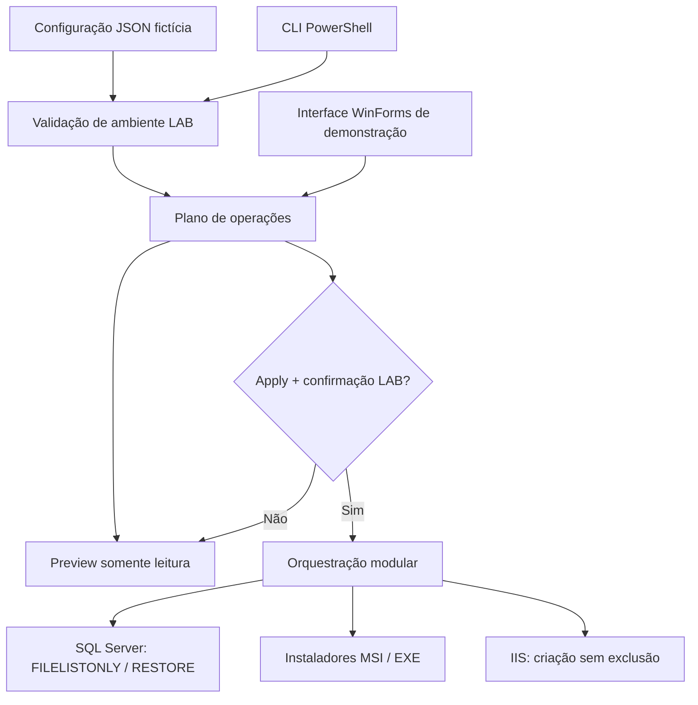

# Arquitetura

## Organização

| Caminho | Responsabilidade |
| --- | --- |
| `Invoke-Provisioning.ps1` | Ponto de entrada por linha de comando |
| `src/ProvisioningToolkit.psm1` | Regras, plano e etapas de provisionamento |
| `gui/Start-Gui.ps1` | Interface gráfica para explorar o plano sem alterações |
| `examples/config.sample.json` | Configuração fictícia para demonstração |
| `tests/*.Tests.ps1` | Testes Pester |
| `.github/workflows/` | Pipeline de validação e testes |

## Decisões de desenho

- **Separar UI de lógica:** a interface importa as funções do módulo, sem duplicá-las.
- **Preview-first:** um usuário que executar o projeto sem opções não altera máquinas ou servidores.
- **Configuração como dados:** recursos SQL/IIS e instaladores não ficam codificados no script.
- **Falhar de forma segura:** colisões com sites/pools já existentes interrompem a operação.
- **Mudanças explícitas:** sem flags de instaladores por tentativa e erro, sem credenciais estáticas.

## Evoluções planejadas

- Logs JSON estruturados, identificação de execução e trilhas de auditoria.
- Tratamento transacional/rollback para recursos parcialmente provisionados.
- Testes de integração em VM efêmera com SQL Server Developer Edition.
- Melhoria do progresso em tempo real e cancelamento das operações.
- Recurso `-WhatIf` baseado em `SupportsShouldProcess` em cada etapa.
